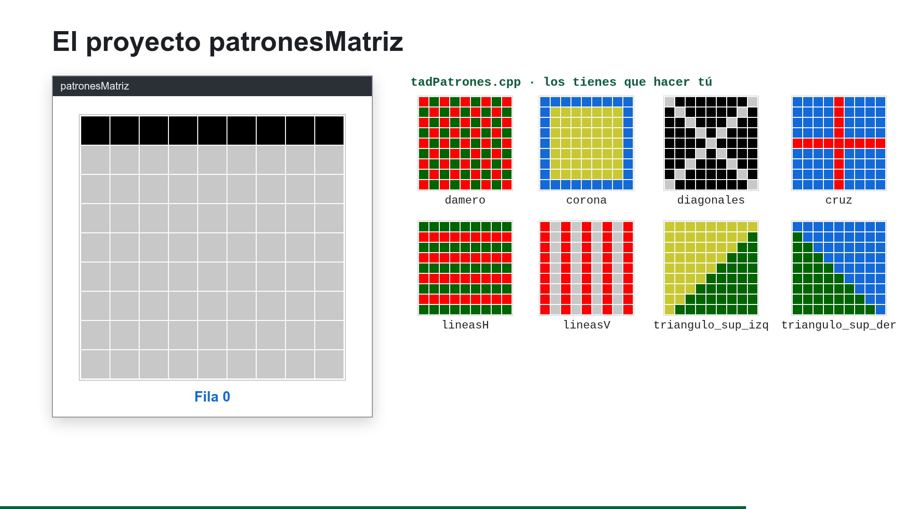

# beats-scenario

Una skill para [Claude](https://claude.com) que prepara presentaciones **por beats** en HTML, CSS y JavaScript puros, sin dependencias ni compilación.

Una presentación por beats no es una lista de diapositivas. Es un escenario fijo en el que **cada clic cambia algo**: una pieza aparece, otra se va, un dibujo se transforma en el siguiente. Pensada para clases, charlas y formaciones en las que el dibujo y el código importan más que las viñetas.

| | |
|---|---|
|  |  |
|  |  |

*Capturas de una clase de Programación hecha con la skill: un vector se convierte en una matriz y la matriz en un cubo, beat a beat.*

## Qué hace

- **Un clic = un beat.** La posición va en la URL (`#3.4` = escena 3, beat 4), así que cualquier beat se reconstruye igual al avanzar, retroceder o recargar.
- **Escenario fijo de 1920×1080** que se escala a cualquier pantalla.
- **Notas y ventana del presentador** (tecla P): nota actual, siguiente, cronómetro y miniatura del próximo beat, sincronizadas con la pantalla principal.
- **Código con líneas resaltadas por beat** y coloreado básico de JavaScript, Python, C/C++ y PHP.
- **Animaciones a medida** con un gancho por escena, para las transformaciones que no salen solo con CSS.
- **Herramientas de comprobación:** capturas de cualquier beat, hoja de contactos y un recorrido completo que avisa de errores, beats sin nota y piezas que se salen del escenario.
- **Sin dependencias.** Un `index.html` que se abre con doble clic, sin servidor y sin conexión.

Teclas: → / clic siguiente · ← anterior · 1–9 escena · O vista general · P presentador · F pantalla completa · B negro.

## Instalación

### Claude Code, como plugin (recomendado)

```
/plugin marketplace add samuelsolis/beats-scenario
/plugin install beats-scenario@beats-scenario
```

### Claude Code, a mano

```bash
git clone https://github.com/samuelsolis/beats-scenario.git
cp -r beats-scenario/plugins/beats-scenario/skills/beats-scenario ~/.claude/skills/
```

### claude.ai (web y escritorio)

Descarga `beats-scenario.zip` de la [última versión](https://github.com/samuelsolis/beats-scenario/releases/latest) y súbelo como skill en los ajustes de capacidades (*Settings → Capabilities → Skills*).

## Uso

Pídele a Claude una presentación como se la pedirías a una persona:

> Prepárame una clase de 15 minutos sobre recursividad para primero de carrera. Estilo sobrio, fondo blanco. El material está en `apuntes.pdf`.

Claude aclara primero qué se quiere contar, a quién y con qué estética; propone el hilo escena a escena y espera tu visto bueno; y luego construye escena a escena, comprobando cada una con capturas. El resultado es una carpeta con:

```
index.html        escenas y notas
tema.css          la estética de esta presentación
base.css          mecánica del escenario (no se toca)
motor.js          beats, URL, teclado, presentador
escenas.js        animaciones a medida
presentador.html  ventana del presentador
herramientas/     capturas y recorrido de comprobación
```

### Lo esencial del formato

```html
<section class="escena" data-id="ejemplo" data-titulo="Ejemplo">
  <p data-in="2">aparece en el beat 2</p>
  <p data-in="2" data-out="4">visible en los beats 2 y 3</p>
  <div data-on="3:resaltado">tiene la clase desde el beat 3</div>
  <pre class="codigo" data-foco="2:1-3 4:5">…</pre>
  <aside class="nota" data-beat="2">qué decir en el beat 2</aside>
</section>
```

El detalle completo, los criterios de diseño y las trampas conocidas están en [`SKILL.md`](plugins/beats-scenario/skills/beats-scenario/SKILL.md).

### Requisitos de las herramientas de comprobación

Solo para las comprobaciones, no para ver la presentación: `google-chrome`, Node ≥ 21 y, para la hoja de contactos, Python con Pillow.

## Licencia

[MIT](LICENSE)
