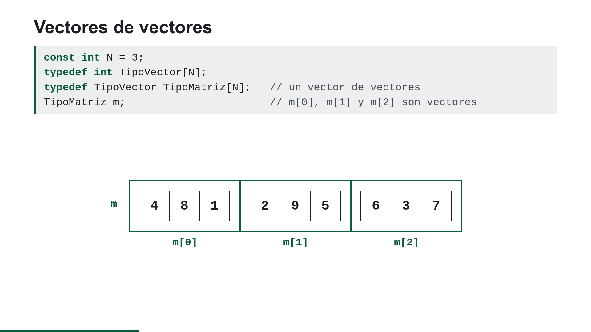
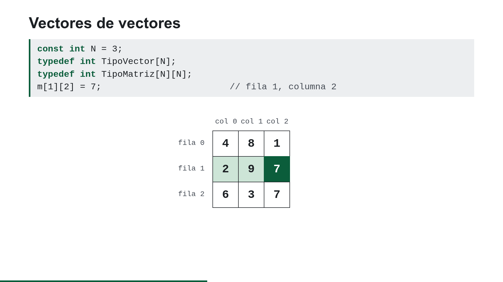
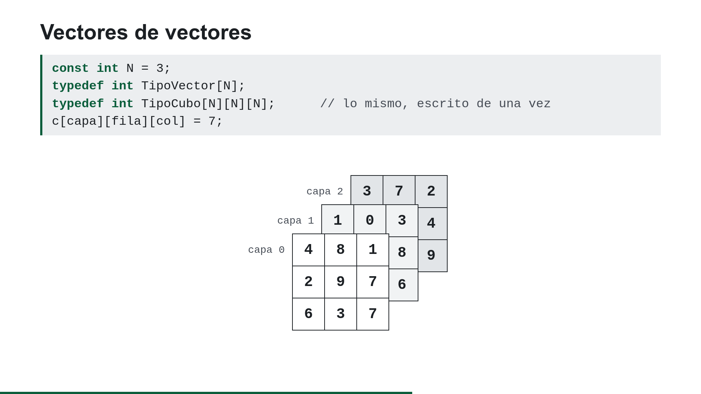

# beats-scenario

**English** · [Español](README.es.md)

A skill for [Claude](https://claude.com) that builds **beat-based** presentations in plain HTML, CSS and JavaScript, with no dependencies and no build step.

A beat-based presentation is not a list of slides. It is a fixed stage where **every click changes something**: a piece appears, another one leaves, a drawing turns into the next one. It is meant for lectures, talks and training sessions where drawings and code matter more than bullet points.

| | |
|---|---|
|  |  |
|  |  |

*Screenshots from a Programming lecture made with the skill (in Spanish): a vector becomes a matrix and the matrix becomes a cube, beat by beat.*

## What it does

- **One click = one beat.** The position lives in the URL (`#3.4` = scene 3, beat 4), so any beat is rebuilt the same way whether you move forward, go back or reload.
- **Fixed 1920×1080 stage** that scales to any screen.
- **Speaker notes and presenter window** (P key): current note, next note, timer and a thumbnail of the next beat, kept in sync with the main screen.
- **Code with lines highlighted per beat** and basic syntax colouring for JavaScript, Python, C/C++ and PHP.
- **Custom animations** through one hook per scene, for transformations that CSS alone can't do.
- **Checking tools:** screenshots of any beat, a contact sheet, and a full walkthrough that reports errors, beats without notes and pieces that overflow the stage.
- **No dependencies.** An `index.html` you open with a double click, with no server and no internet connection.

Keys: → / click next · ← previous · 1–9 scene · O overview · P presenter · F fullscreen · B black screen.

## Installation

### Claude Code, as a plugin (recommended)

```
/plugin marketplace add samuelsolis/beats-scenario
/plugin install beats-scenario@beats-scenario
```

### Claude Code, by hand

```bash
git clone https://github.com/samuelsolis/beats-scenario.git
cp -r beats-scenario/plugins/beats-scenario/skills/beats-scenario ~/.claude/skills/
```

### claude.ai (web and desktop)

Download `beats-scenario.zip` from the [latest release](https://github.com/samuelsolis/beats-scenario/releases/latest) and upload it as a skill in *Settings → Capabilities → Skills*.

## Usage

Ask Claude for a presentation the way you would ask a person:

> Prepare a 15-minute lecture on recursion for first-year students. Plain style, white background. The material is in `notes.pdf`.

Claude first clarifies what you want to tell, to whom and with what look. Then it proposes the storyline scene by scene and waits for your go-ahead. Finally it builds the presentation scene by scene, checking each one with screenshots. Claude writes the presentation in your language. The result is a folder with:

```
index.html        scenes and notes
tema.css          the look of this presentation
base.css          stage mechanics (not to be edited)
motor.js          beats, URL, keyboard, presenter
escenas.js        custom animations
presentador.html  presenter window
herramientas/     screenshots and walkthrough checks
```

The file names and the attributes of the format are in Spanish, the language the skill was born in.

### The essentials of the format

```html
<section class="escena" data-id="example" data-titulo="Example">
  <p data-in="2">appears at beat 2</p>
  <p data-in="2" data-out="4">visible at beats 2 and 3</p>
  <div data-on="3:highlighted">has the class from beat 3 on</div>
  <pre class="codigo" data-foco="2:1-3 4:5">…</pre>
  <aside class="nota" data-beat="2">what to say at beat 2</aside>
</section>
```

| Attribute | Meaning |
|---|---|
| `data-in="n"` | visible from beat *n* |
| `data-out="n"` | hidden from beat *n* |
| `data-on="n:class"` / `"n-m:class"` | adds the class from beat *n* (or only from *n* to *m*) |
| `data-foco="beat:lines"` | highlights code lines at that beat |
| `data-fuera` | on a scene: parks it (stays in the HTML, not shown) |
| `<aside class="nota" data-beat="n">` | speaker note for beat *n* |

The full details, design criteria and known pitfalls are in [`SKILL.md`](plugins/beats-scenario/skills/beats-scenario/SKILL.md) (in Spanish; Claude reads it in any language).

### Requirements for the checking tools

Only for the checks, not for viewing the presentation: `google-chrome`, Node ≥ 21 and, for the contact sheet, Python with Pillow.

## License

[MIT](LICENSE)
